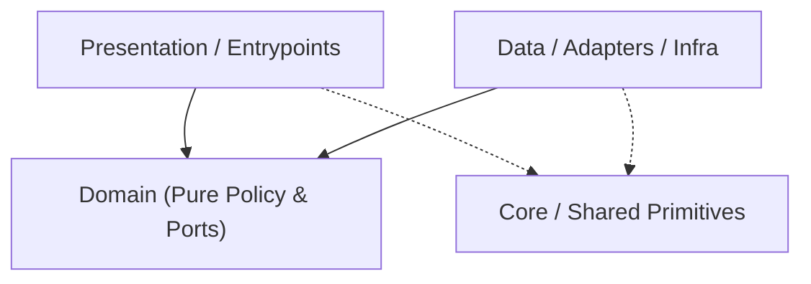

# Codebase Architecture Map — `yomu-pipeline`

> Auto-generated by `project-pro map` (2026-11-09 15:07 UTC). Read this first to save exploration tokens.
- **Detected Stack**: `rust` | **Mode**: `configured`

## 1. Canonical Layer Dependency Flow

## 2. Layer Distribution (Code Files)
- **Domain**: `0` | **Data/Infra**: `0` | **Presentation/UI**: `0` | **Core/Shared**: `0` | **Tests**: `7` | **Other**: `13`

## 3. Module / Directory Index (Top Slices)
- `src/` — `6` files (`896` LOC)
- `src/bin/` — `1` files (`217` LOC)
- `src/inpaint/` — `2` files (`369` LOC)
- `src/layout/` — `2` files (`418` LOC)
- `src/typography/` — `2` files (`313` LOC)
- `tests/` — `7` files (`567` LOC)
