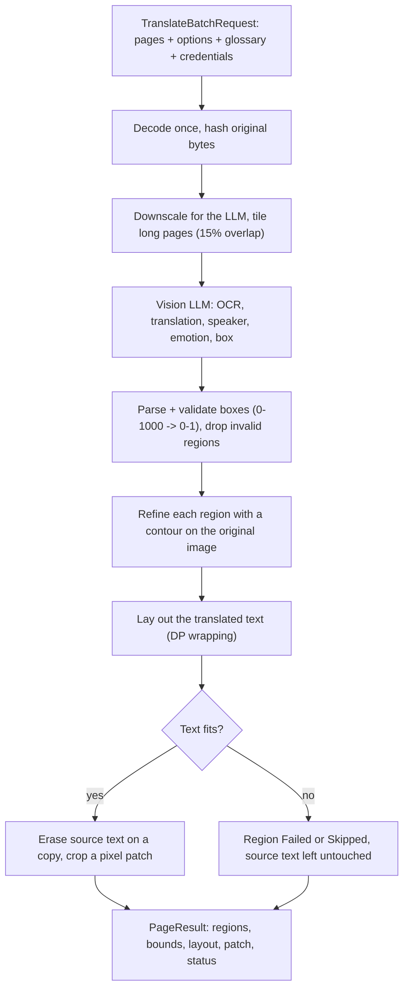

# yomu-pipeline

Independent, headless comic & manga translation engine:
- Bubble contour detection & line slice calculation
- Statistical flat fill & smart inpaint (Otsu thresholding, variance rejection)
- Dynamic programming text wrapping with Vietnamese typography heuristics
- Typography inference (stroke width, core color, rotation, vertical orientation)
- Pure Rust headless typesetting & glyph rasterization (`ab_glyph`)
- Standalone CLI & headless background worker daemon

## Architecture & Features

`yomu-pipeline` is completely decoupled from any GUI or app framework (zero `egui`, zero `eframe`, zero `yomu` internal dependencies). It operates on pure DTOs and standard `image::RgbaImage` buffers.

- `contour`: 8-connected flood fill, row span anchoring, enclosed hole filling.
- `inpaint`: Statistical median background sampling, border mask preservation.
- `layout`: Dynamic programming line badness minimization, Vietnamese preposition/conjunction break penalties.
- `typography`: Radon transform tilt detection, vertical writing detection, ink cluster sampling.
- `render`: Font renderer with bundled Vietnamese diacritics font (`BeVietnamPro-Regular.ttf`) and custom font support.
- `pipeline`: Single-call `process_page` combining typography inference, inpainting, and typesetting.

## Translation Flow

Target flow of the translation engine. The app sends a list of page images; the engine returns, per page and per region, the translation, coordinates, text layout and the erased pixels. The app only stores results and draws. See `docs/architecture/ADR-0002-engine-contract.md` for the full contract and the system-wide flow in the `yomu` README.



### Stages

| Stage | What happens | Status |
|---|---|---|
| Decode + hash | Decode the original once; hash the original bytes (`cache_key` input). Never re-compress an already compressed copy | Planned |
| LLM preprocess | Downscale (current app default: long edge 1280 px, JPEG q82, single-channel JPEG for near-gray pages); tile tall pages with overlap instead of shrinking them | Exists in the app (`translation_adapters/image_opt.rs`), to be moved here |
| LLM call | Prompt + schema, retry per HTTP call, typed `ProviderError` (rate limit, quota, auth, timeout, invalid response) | Exists in the app (`vision_llm.rs`), to be moved here |
| Glossary | Series glossary, character list, pronoun pairs, speaker/emotion carried from previous pages are injected into the prompt | Data model exists in the app; not wired into the prompt yet |
| Contour | 8-connected flood fill, hole filling; falls back to a rectangle from the bounds | Implemented (`src/contour.rs`, `src/inpaint/region.rs`) |
| Layout | Dynamic-programming line breaking with Vietnamese break penalties. Runs **before** erasing | Implemented (`src/layout/`) |
| Erase | `StatisticalFlatFill` for flat backgrounds, `smart_inpaint` when a bubble outline was detected, otherwise the region is skipped (`ComplexBackground`). Works on a copy; the input image is never modified | Implemented in `process_page` (`src/pipeline.rs`); per-region patch output planned |
| Draw | `FontRenderer` rasterizes the layout (BeVietnamPro). In overlay mode the client draws the text itself from `TextLayoutV1` | Implemented (always baked today); no-bake option planned |

### What the engine returns

- `RegionResult` per region: `kind`, `source_text`, `translated_text`, `bounds` (normalized to the page), `typography`, `layout` (`origin_px` is the pen origin on the alphabetic baseline, in source-image pixels), and `status`.
- `status` is `Rendered`, `Skipped{reason}` or `Failed{reason}`. **A region that is not `Rendered` never has its source text erased and has no patch** (`erase = None`). The engine never reports a blanket success when some regions were not drawn; the CLI reports `ok`, `partial` or `skipped`.
- Erase output (decision pending owner confirmation): one `Patch` per `Rendered` region, cropped from the cleaned image at the source resolution (raw RGBA in-process, PNG over the network), plus a helper `apply_erase(original, regions)` that rebuilds the cleaned full page. Clients only paste patches; they do not run any inpaint algorithm.
- Nothing is persisted by the engine. In server mode everything is processed in memory and logs hold metadata only.

### Transports

Same contract, two ways to run it:
- **Embedded**: the app calls the library in-process. No network between the app and the engine; only the LLM upload. Free tier, user-supplied API key stored on the device.
- **Backend**: a server wraps the engine over HTTP. Paid tier, project-owned key on the server, per-account limits. The client uploads the downscaled page and downloads only regions and patches.

### Known limitations

- `inpaint_page` erases without checking that the translation fits; use `process_page` when text will be drawn afterwards.
- `Bytes` in JSON are number arrays (no base64 yet) and the contract is not yet wired into `process_page`.
- Layout is very slow on extremely long text (about 2000 words); a word or iteration limit is planned.

## Usage

### As a Library

```rust
use yomu_pipeline::{process_page, FontRenderer, PipelineOptions, RegionInput, NormalizedRect, BubbleStyleHint};
use image::open;

let img = open("page.jpg")?.into_rgba8();
let renderer = FontRenderer::default();

let regions = vec![
    RegionInput {
        id: "b1".into(),
        bounds: NormalizedRect::new(0.1, 0.1, 0.3, 0.2)?,
        text: "Xin chào thế giới manga!".into(),
        style_hint: BubbleStyleHint::Balloon,
        kind: Default::default(),
        typography: None,
    }
];

let result = process_page(&img, &regions, &renderer, PipelineOptions::default());
result.image.save("page_translated.png")?;
```

### CLI Command

```sh
# Single page translation & inpainting
yomu-pipeline inpaint --image page.jpg --regions regions.json --output page_translated.png

# Headless worker daemon reading JSON lines from stdin
yomu-pipeline worker
```

## Testing & Quality

```sh
cargo test
cargo fmt --all -- --check
cargo clippy --all-targets -- -D warnings
```
